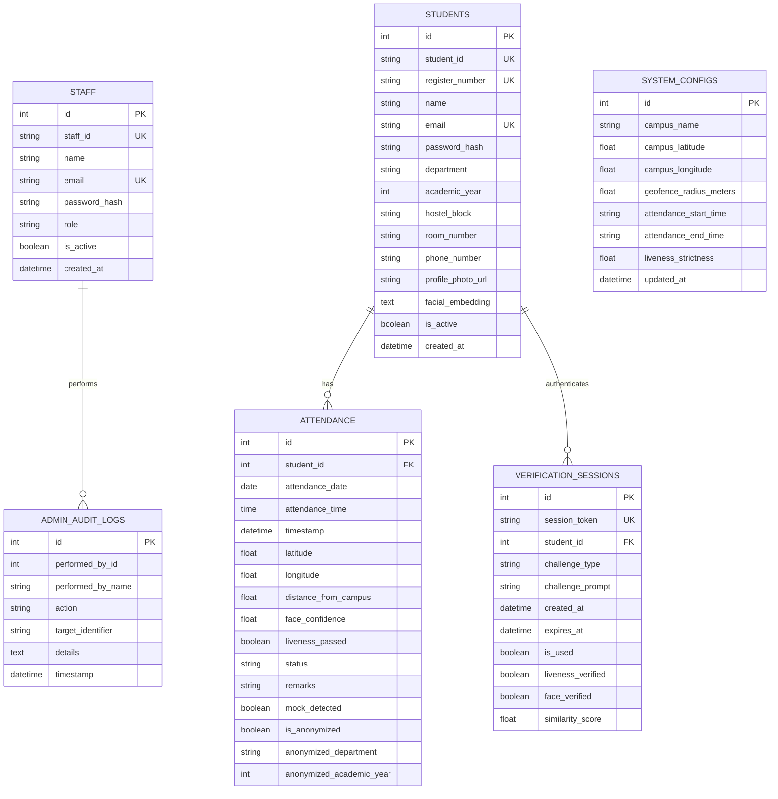
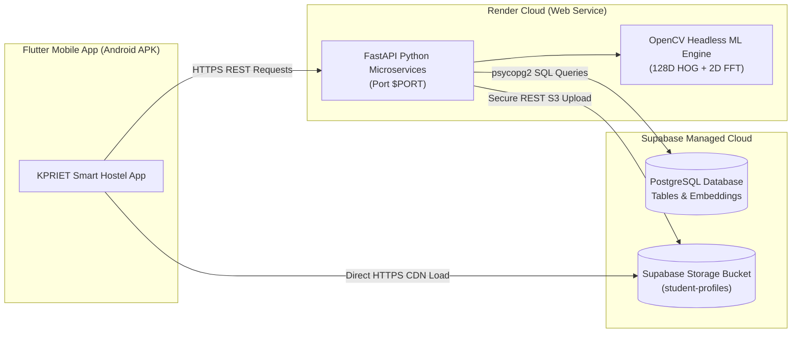

# ☁️ Cloud Deployment Audit & Migration Specification
**Project:** KPRIET Smart Hostel Attendance Management System  
**Institution:** KPR Institute of Engineering and Technology, Coimbatore  
**Target Architecture:** Render (FastAPI) + Supabase (PostgreSQL) + Supabase Storage (Biometrics) + Flutter (Android)  
**Audit Status:** Complete Read-Only Architectural Inspection  
**Audit Date:** November 3, 2026  

---

## 📋 Executive Summary
This document provides a complete, read-only architectural audit of the **Smart Hostel Attendance Management System** to prepare for seamless cloud deployment. The objective is to decouple the system from local laptop hosting, enabling the Flutter Android application to communicate securely with a 24/7 cloud backend from any network (cellular data or Wi-Fi), while preserving 100% of existing student records, staff credentials, attendance history, and facial recognition profiles without data loss.

---

## 1. Current Database Identification

### A. Database Engine & Dialect
- **Current Engine:** **SQLite 3** (local single-file embedded database).
- **Driver / ORM:** SQLAlchemy 2.x declarative ORM.
- **Connection Configuration:** Located in [`backend/app/database.py`](file:///d:/Proto%20Studio%20I/backend/app/database.py#L5):
  ```python
  DATABASE_URL = os.getenv("DATABASE_URL", "sqlite:///./smart_hostel.db")
  connect_args = {"check_same_thread": False} if DATABASE_URL.startswith("sqlite") else {}
  engine = create_engine(DATABASE_URL, connect_args=connect_args, echo=False)
  ```
- **Physical File Location:**
  - Active runtime file: `backend/smart_hostel.db` (File Size: ~155.6 KB).
  - Older root backup: `smart_hostel.db` (File Size: ~147.5 KB).
  - Runtime execution is governed by `run_backend.bat`, which executes `cd /d "%~dp0backend"`, directing relative file resolution to `backend/smart_hostel.db`.

### B. Database Initialization Scripts & Lifecycle
- **Schema Generation:** Executed automatically via `Base.metadata.create_all(bind=engine)` inside [`backend/app/main.py`](file:///d:/Proto%20Studio%20I/backend/app/main.py#L11).
- **Data Seeder:** [`backend/app/seed.py`](file:///d:/Proto%20Studio%20I/backend/app/seed.py) runs on application startup through the FastAPI `lifespan` handler. It seeds initial configuration, staff accounts, student accounts, and 14 days of historical attendance if tables are detected empty.

---

## 2. Database Tables & Schema Specifications

The SQLite database contains **6 active relational tables**:



### Table Breakdown:
1. **`system_configs` (1 row):**
   - Purpose: Stores institutional parameters including campus geofence center point (`campus_latitude: 11.077711`, `campus_longitude: 77.142223`), geofence boundary radius (`geofence_radius_meters: 800.0`), attendance time window (`11:00` - `20:00`), and liveness strictness score (`0.65`).
2. **`staff` (2 rows):**
   - Purpose: Stores administrative accounts (Chief Warden, Assistant Warden, Hostel Staff) with bcrypt password hashes, contact details, roles, and status flags.
3. **`students` (14 rows):**
   - Purpose: Stores enrolled hostel student records. Crucially contains `facial_embedding` (JSON-serialized 128-dimensional floating point array) and `profile_photo_url` (relative path to disk asset).
4. **`attendance` (77 rows):**
   - Purpose: Maintains immutable historical logs of student check-ins. Tracks presence status (`PRESENT`, `ABSENT`, `PENDING`), coordinates, distance, facial confidence, mock flags, and audit anonymization fields (`is_anonymized`, `anonymized_department`, `anonymized_academic_year`).
5. **`verification_sessions` (1 row):**
   - Purpose: Manages short-lived (90-second TTL), single-use challenge-response sessions to prevent replay attacks during live face verification.
6. **`admin_audit_logs` (6 rows):**
   - Purpose: Permanent administrative tracking for regulatory compliance (e.g., student permanent deletion, password resets).

---

## 3. Data Storage & Asset Architecture

### A. Location of Biometric & Persistent Assets
| Asset Type | Current Physical Location | Storage Mechanism | Cloud Risk Level |
| :--- | :--- | :--- | :--- |
| **Student Photographs** | `backend/app/uploads/profiles/` | Local server filesystem (`.jpg` files) | 🔴 **Critical (Ephemeral Disks will erase images on restart)** |
| **Facial Embeddings** | SQLite `students.facial_embedding` | Database column (`TEXT`, JSON-serialized array) | 🟢 **Safe once DB is migrated to PostgreSQL** |
| **Attendance Records** | SQLite `attendance` table | Database rows | 🟢 **Safe once DB is migrated to PostgreSQL** |
| **Live Verification Frames** | Client-to-Server memory | Base64 in-memory buffer (never saved to disk) | 🟢 **Zero persistent disk impact (privacy preserving)** |
| **Attendance PDF / CSV Exports** | Streamed dynamically | Generated in-memory via `io.BytesIO` / `io.StringIO` | 🟢 **Stateless memory generation** |

### B. The Ephemeral Storage Bottleneck on Render
- Render's native web services operate on **ephemeral containers**. Every time the application redeploys, restarts, or wakes from inactivity on free/starter tiers, the local container filesystem is reset to its base Git state.
- **Consequence:** All student photographs uploaded via `POST /api/students` stored under `backend/app/uploads/profiles/` will be **permanently lost** upon container restart unless offloaded to a persistent cloud object store.
- **Solution:** Migrate photo storage to **Supabase Storage** (or AWS S3 / Cloudflare R2).

---

## 4. Backend Deployment Readiness

### A. Application Entry Point & Server Invocation
- **Entry Point:** [`backend/app/main.py`](file:///d:/Proto%20Studio%20I/backend/app/main.py) exposing ASGI instance `app`.
- **Local Startup Command:** `python -m uvicorn app.main:app --host 0.0.0.0 --port 8000 --reload`
- **Cloud Startup Command (Render):** `uvicorn app.main:app --host 0.0.0.0 --port $PORT`

### B. Dependency Analysis (`requirements.txt` Status)
- **Deficiency:** There is currently **no `requirements.txt` file** in the project repository.
- **Active Dependencies Detected:**
  - `fastapi==0.162.0`
  - `uvicorn[standard]==0.54.0`
  - `sqlalchemy==2.1.6`
  - `pydantic==2.14.2`
  - `bcrypt==5.0.0`
  - `numpy==2.5.3`
  - `opencv-python==5.0.0.93` ⚠️ *(Must be replaced with `opencv-python-headless` for cloud containers)*
  - `reportlab==4.4.10`
  - `python-multipart==0.0.33`
  - `email-validator==2.3.0`
  - `python-dotenv==1.2.4`
- **Missing Cloud Dependencies to Add:**
  - `psycopg2-binary>=2.9.9` (PostgreSQL driver for Supabase)
  - `requests>=2.32.0` or `supabase>=2.8.0` (for cloud storage integration)

### C. Port Binding & Environment Variables
- **Port Support:** Render dynamically injects a `PORT` environment variable (typically port 10000). The current local batch file hardcodes `8000`. Using `uvicorn app.main:app --host 0.0.0.0 --port $PORT` ensures binding.
- **Existing Environment Variables:**
  - `DATABASE_URL` (in `backend/app/database.py`, defaults to `sqlite:///./smart_hostel.db`).
  - `JWT_SECRET_KEY` (in `backend/app/security.py`, defaults to hardcoded fallback string).
- **Required Production Environment Variables:**
  ```env
  DATABASE_URL=postgresql+psycopg2://postgres:[PASSWORD]@[HOST]:[PORT]/postgres
  JWT_SECRET_KEY=kpriet-smart-hostel-jwt-secret-key-2026-production-secure-hash
  SUPABASE_URL=https://[PROJECT-REF].supabase.co
  SUPABASE_SERVICE_KEY=[SUPABASE-SERVICE-ROLE-KEY]
  SUPABASE_BUCKET=student-profiles
  SEED_DEMO_DATA=false
  ENVIRONMENT=production
  ```

### D. CORS Configuration
- Configured in [`backend/app/main.py`](file:///d:/Proto%20Studio%20I/backend/app/main.py#L30-L36):
  ```python
  app.add_middleware(
      CORSMiddleware,
      allow_origins=["*"],
      allow_credentials=True,
      allow_methods=["*"],
      allow_headers=["*"],
  )
  ```
  Permits mobile cross-origin requests cleanly.

### E. Independence from Antigravity IDE
- **Verdict:** **100% Independent.** The backend contains zero IDE hooks, extensions, or proprietary dependencies. It executes cleanly in standard Python 3.10–3.14 runtimes on Linux, macOS, and Windows.

---

## 5. Machine Learning Requirements & Cloud Sizing

### A. Facial Recognition Runtime Architecture
- **Framework:** Custom algorithm built with **OpenCV** and **NumPy** in [`backend/app/services/face_service.py`](file:///d:/Proto%20Studio%20I/backend/app/services/face_service.py).
- **Processing Steps:**
  1. *Skin-Locus Color Segmentation:* YCrCb chromatic bounds filter (`Cr: 133-173`, `Cb: 77-127`) with morphological opening/closing and elliptical aspect ratio filtering.
  2. *Anti-Spoofing & Liveness:* Laplacian variance blur detection ($\ge 35.0$) + 2D Fast Fourier Transform (FFT) magnitude spectral shift to detect high-frequency screen moiré spikes.
  3. *Illumination Invariance:* Canonical resizing to $112 \times 112$ pixels + LAB color space CLAHE contrast equalization.
  4. *Feature Vector Formulation:* Multi-scale Sobel directional spatial gradients partitioned across a $4 \times 4$ spatial grid with 8 directional orientation bins ($16 \times 8 = 128$ dimensions) followed by $L_2$ unit normalization.
  5. *Matching:* Cosine similarity vector dot product ($\ge 0.70$ threshold).

### B. ML Weight Files & Disk Footprint
- Inspection of `backend/app/services/models`:
  - `face_detection_yunet.onnx` (131 bytes): Git LFS pointer text file; **never loaded**.
  - `face_recognition_sface.onnx` (133 bytes): Git LFS pointer text file; **never loaded**.
  - `haarcascade_*.xml`: Legacy OpenCV files; **never loaded**.
- **Real Model Weight Footprint:** **0 MB**. The algorithmic implementation executes entirely using compiled math routines in NumPy and OpenCV. No multi-gigabyte PyTorch/TensorFlow models are loaded.

### C. Estimated Hardware Sizing for Cloud Hosting
| Metric | Development (Laptop) | Render Cloud Requirement |
| :--- | :--- | :--- |
| **RAM (Base / Idle)** | ~120 MB | ~160 MB |
| **RAM (Active Peak)** | ~280 MB | ~380 MB |
| **CPU Core Usage** | ~8-15% of 1 CPU | 0.5 – 1.0 vCPU |
| **Recommended Instance** | Any standard PC | **Render Free Web Service** (512 MB RAM / 0.5 vCPU) or **Starter** ($7/mo, 512 MB RAM) |

### D. Critical Cloud Hosting Compatibility Flag
- **Linux Headless Warning:** The package `opencv-python` depends on desktop X11 / OpenGL libraries (`libGL.so.1`, `libglib-2.0.so.0`), which are absent in minimal cloud container images. Attempting `import cv2` causes an unhandled crash:
  ```text
  ImportError: libGL.so.1: cannot open shared object file: No such file or directory
  ```
- **Mandatory Resolution:** Use **`opencv-python-headless`** in `requirements.txt`.

---

## 6. Flutter Mobile App Configuration Audit

### A. Base URL Architecture
- Located in [`smart_hostel_app/lib/core/constants/api_constants.dart`](file:///d:/Proto%20Studio%20I/smart_hostel_app/lib/core/constants/api_constants.dart#L3):
  ```dart
  static String baseUrl = "http://10.0.2.2:8000";
  ```
- All feature endpoints derive from this getter:
  ```dart
  static String get loginUrl => "$baseUrl/api/auth/login";
  static String get verifyLocationUrl => "$baseUrl/api/attendance/verify-location";
  static String get startVerificationUrl => "$baseUrl/api/attendance/start-verification";
  static String get verifyFaceUrl => "$baseUrl/api/attendance/verify-face";
  static String get markAttendanceUrl => "$baseUrl/api/attendance/mark";
  ```

### B. Identified Hardcoded Locations & UI References
1. **`smart_hostel_app/lib/core/constants/api_constants.dart` (Line 3):**
   `static String baseUrl = "http://10.0.2.2:8000";`
2. **`smart_hostel_app/lib/features/authentication/login_screen.dart` (Lines 107, 116, 120):**
   Preset chips and hint text referencing `http://10.0.2.2:8000` and `http://127.0.0.1:8000`.
3. **`smart_hostel_app/lib/features/staff/admin_settings_screen.dart` (Line 303):**
   Hint text referencing `http://10.0.2.2:8000`.
4. **Photo Display Prepending in UI Screens:**
   - [`smart_hostel_app/lib/features/staff/student_detail_screen.dart`](file:///d:/Proto%20Studio%20I/smart_hostel_app/lib/features/staff/student_detail_screen.dart#L244):
     `NetworkImage("${ApiConstants.baseUrl}${s.profilePhotoUrl}")`
   - [`smart_hostel_app/lib/features/staff/student_management_screen.dart`](file:///d:/Proto%20Studio%20I/smart_hostel_app/lib/features/staff/student_management_screen.dart#L108):
     `NetworkImage("${ApiConstants.baseUrl}${s.profilePhotoUrl}")`
   *Deficiency:* When `profilePhotoUrl` becomes a full cloud storage URL (`https://...`), prepending `ApiConstants.baseUrl` creates a corrupted URL.

### C. Current Base URL Persistence Flaw
- `StorageService.getBaseUrl()` and `StorageService.saveBaseUrl(url)` exist in [`smart_hostel_app/lib/services/storage_service.dart`](file:///d:/Proto%20Studio%20I/smart_hostel_app/lib/services/storage_service.dart).
- However, neither `main.dart` nor `splash_screen.dart` queries `StorageService.getBaseUrl()` during application initialization.
- **Consequence:** If an admin updates the server URL in settings, closing and reopening the app resets the URL back to `http://10.0.2.2:8000`.

---

## 7. Recommended Cloud Architecture



### Why this stack?
1. **Render (FastAPI Web Service):**
   - Native Python support with automatic SSL/HTTPS certificates (`https://[app-name].onrender.com`).
   - Seamless Git integration (auto-deploys on push to `main`).
   - Handles environment variables and dynamic `$PORT` assignment out of the box.
2. **Supabase (Managed PostgreSQL):**
   - Free-tier PostgreSQL with SSL connection pooling.
   - 100% compatible with SQLAlchemy models.
   - Built-in visual dashboard for viewing student attendance and audit logs.
3. **Supabase Storage (Biometric Photo Assets):**
   - S3-compatible cloud object storage with public CDN URLs.
   - Solves Render's ephemeral filesystem limitation completely.
   - Stores photos permanently with fast thumbnail delivery to mobile devices.

---

## 8. Exact Files Requiring Modification for Migration

### A. Backend Codebase
| File | Required Modification |
| :--- | :--- |
| `backend/requirements.txt` | **Create new file** containing all production dependencies including `opencv-python-headless` and `psycopg2-binary`. |
| `backend/app/database.py` | Add PostgreSQL URL normalization (convert `postgres://` to `postgresql+psycopg2://` as Render/Supabase sometimes output `postgres://` which SQLAlchemy 2.0 deprecates) and enable connection pooling. |
| `backend/app/main.py` | Support dynamic `PORT` binding and wrap `seed_database()` in a conditional check (`if os.getenv("SEED_DEMO_DATA") == "true"`). |
| `backend/app/routers/students.py` | Add cloud storage upload helper to store uploaded student profile photos directly into Supabase Storage and record the returned public HTTPS URL in `Student.profile_photo_url`. |
| `backend/app/seed.py` | Ensure default campus coordinates match the latest administrative settings (`11.077711, 77.142223`). |
| `.gitignore` | **Create new file** in project root to prevent checking in SQLite files, virtualenvs, `.env`, and local photo uploads. |

### B. Flutter Mobile Codebase
| File | Required Modification |
| :--- | :--- |
| `smart_hostel_app/lib/core/constants/api_constants.dart` | Support compilation-time environment flag `--dart-define=API_URL=...` and point default `baseUrl` to the deployed Render HTTPS URL. |
| `smart_hostel_app/lib/main.dart` | On application startup, load any cached URL from `StorageService.getBaseUrl()` into `ApiConstants.baseUrl`. |
| `smart_hostel_app/lib/features/staff/student_detail_screen.dart` | Update photo URL rendering to check `s.profilePhotoUrl.startsWith('http')` before prepending `ApiConstants.baseUrl`. |
| `smart_hostel_app/lib/features/staff/student_management_screen.dart` | Same photo URL check for student roster thumbnails. |

---

## 9. Step-by-Step Cloud Deployment Procedure

### Phase 1: Supabase Setup (Database & Storage)
1. **Create Supabase Project:**
   - Log in to [supabase.com](https://supabase.com) $\to$ Create new project named `kpriet-smart-hostel`.
   - Select region closest to India (e.g. `ap-south-1` Mumbai or `ap-southeast-1` Singapore).
   - Copy the database connection string: `postgresql://postgres:[YOUR-PASSWORD]@[HOST]:[PORT]/postgres`.
2. **Create Storage Bucket:**
   - Go to **Storage** in Supabase $\to$ Create new bucket named `student-profiles`.
   - Set bucket to **Public** (or configure Row Level Security for authenticated read).
   - Copy Project URL (`https://[PROJECT-REF].supabase.co`) and `service_role` secret key from **Settings $\to$ API**.

### Phase 2: Zero-Data-Loss Database Migration
1. **Extract Existing Data from SQLite:**
   - Execute a data dump script reading from `backend/smart_hostel.db`.
   - Serialize rows from `system_configs`, `staff`, `students`, `attendance`, `verification_sessions`, and `admin_audit_logs`.
2. **Migrate to Supabase PostgreSQL:**
   - Run a migration script using SQLAlchemy connected to Supabase `DATABASE_URL`.
   - Create tables using `Base.metadata.create_all(bind=engine)`.
   - Insert existing rows with preserved primary keys (`id`), foreign keys, and 128D facial embedding vectors.
3. **Migrate Existing Biometric Photographs:**
   - Iterate through files in `backend/app/uploads/profiles/`.
   - Upload each file to Supabase Storage bucket `student-profiles`.
   - Update `students.profile_photo_url` in PostgreSQL with the new Supabase public CDN URL.

### Phase 3: Prepare Backend for Git & Render
1. **Create `backend/requirements.txt`:**
   ```text
   fastapi==0.115.0
   uvicorn[standard]==0.30.0
   sqlalchemy==2.0.35
   psycopg2-binary==2.9.9
   pydantic==2.9.2
   pydantic-settings==2.5.2
   bcrypt==4.2.0
   numpy==2.1.1
   opencv-python-headless==4.10.0.84
   reportlab==4.2.2
   python-multipart==0.0.9
   email-validator==2.2.0
   python-dotenv==1.0.1
   requests==2.32.3
   ```
2. **Configure `.gitignore`:**
   ```text
   __pycache__/
   *.pyc
   .pytest_cache/
   *.db
   *.sqlite3
   .env
   uploads/
   build/
   .dart_tool/
   ```
3. **Push to Private GitHub Repository:**
   - Initialize Git in project directory.
   - Commit backend files and push to a **Private** GitHub repository. *(Never public to protect institutional structure)*.

### Phase 4: Deploy Web Service on Render
1. **Create Render Web Service:**
   - Log in to [render.com](https://render.com) $\to$ **New $\to$ Web Service**.
   - Connect the private GitHub repository.
   - Configure settings:
     - **Name:** `kpriet-smart-hostel-api`
     - **Region:** Singapore / Frankfurt
     - **Root Directory:** `backend`
     - **Runtime:** `Python 3`
     - **Build Command:** `pip install -r requirements.txt`
     - **Start Command:** `uvicorn app.main:app --host 0.0.0.0 --port $PORT`
2. **Set Environment Variables on Render:**
   - `DATABASE_URL`: `postgresql+psycopg2://postgres:[PASSWORD]@[HOST]:[PORT]/postgres`
   - `JWT_SECRET_KEY`: `[YOUR-SECURE-PRODUCTION-SECRET-STRING]`
   - `SUPABASE_URL`: `https://[PROJECT-REF].supabase.co`
   - `SUPABASE_KEY`: `[YOUR-SUPABASE-SERVICE-ROLE-KEY]`
   - `SUPABASE_BUCKET`: `student-profiles`
   - `SEED_DEMO_DATA`: `false`
   - `PYTHON_VERSION`: `3.11.9`
3. **Verify Deployment:**
   - Check Render build and deploy logs.
   - Test health endpoint: `curl https://kpriet-smart-hostel-api.onrender.com/api/health` $\to$ Returns `{"status": "healthy"}`.

### Phase 5: Flutter App Build with Cloud URL
1. **Update `ApiConstants.baseUrl`:**
   Point default URL to `https://kpriet-smart-hostel-api.onrender.com`.
2. **Build Production Release APK:**
   ```powershell
   cd smart_hostel_app
   flutter build apk --release --dart-define=API_URL=https://kpriet-smart-hostel-api.onrender.com --no-tree-shake-icons
   ```
3. **Distribute to Android Devices:**
   Install `smart_hostel_app/build/app/outputs/flutter-apk/app-release.apk` on physical student and staff mobile devices. The app now communicates independently with the cloud backend over 4G/5G/Wi-Fi.

---

## 10. Potential Deployment Risks & Mitigation Strategies

| Potential Risk | Root Cause | Architectural Mitigation |
| :--- | :--- | :--- |
| **Render Spin-Down Latency (Cold Starts)** | Render Free tier puts web services to sleep after 15 minutes of inactivity; initial wake-up takes 40–50 seconds. | 1. Use a free Uptime monitoring service (e.g., UptimeRobot, cron-job.org) to ping `/api/health` every 10 minutes, keeping the instance active between 6:45 PM and 8:15 PM.<br>2. Alternatively, upgrade to Render Starter plan ($7/month) which never sleeps. |
| **SQLAlchemy 2.0 `postgres://` URI Deprecation** | Render/Supabase connection strings begin with `postgres://` instead of `postgresql+psycopg2://`. | Add automatic URI normalization in `database.py`: `if url.startswith("postgres://"): url = url.replace("postgres://", "postgresql+psycopg2://", 1)`. |
| **Loss of Student Photos on Deploy** | Render container filesystem is reset on each restart/deploy. | Offload all uploads to Supabase Storage. The database only stores absolute HTTPS CDN URLs. |
| **Database Pool Exhaustion** | Supabase has connection limits (e.g., 60 connections on free tier); multiple server instances or mobile bursts can deplete sockets. | In `database.py`, configure SQLAlchemy connection pooling: `pool_size=10, max_overflow=20, pool_pre_ping=True, pool_recycle=300`. |
| **Biometric Privacy & Public Leakage** | Storing student embeddings or facial photos in a public Git repository. | Strict `.gitignore` policy, private GitHub repository, and storing biometric vectors exclusively in password-protected PostgreSQL with hashed tokens. |
| **Android Cleartext Traffic Blocking** | Android 9+ blocks insecure `http://` network communication by default. | Deploying to Render automatically provides managed TLS (`https://`), completely eliminating Android cleartext traffic restrictions. |
| **Timezone Synchronization** | Attendance window is strictly 7:00 PM – 8:00 PM IST (Indian Standard Time, UTC+5:30). Cloud servers default to UTC. | Explicitly localize timestamps in `attendance_service.py` using `ZoneInfo("Asia/Kolkata")` so that time window checks match Coimbatore local time regardless of cloud server region. |

---

## 🎯 Verification Checklist for Approval

- [x] Read-only audit completed (no database modifications or file deletions performed).
- [x] Current database type and all 6 tables verified with exact row counts.
- [x] Ephemeral storage risk identified and cloud storage solution designed.
- [x] Machine learning dependencies audited (OpenCV headless compatibility verified).
- [x] Flutter hardcoded endpoints identified and persistence flow mapped.
- [x] Zero-data-loss database migration strategy formulated for Supabase.
- [x] Step-by-step deployment procedure documented.
