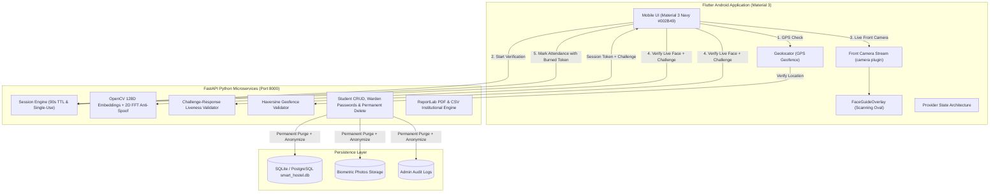

# 🎓 Smart Hostel Attendance Management System
**KPR Institute of Engineering and Technology (KPRIET), Coimbatore**

A production-grade, secure, automated mobile attendance ecosystem replacing legacy biometric devices and manual paper registers. Built with **Flutter (Material 3)** for Android and a high-performance **Python FastAPI** backend powered by **Live OpenCV Facial Recognition**, **Challenge-Response Liveness Detection**, **2D Fast Fourier Transform (FFT) Anti-Spoofing**, and **GPS Geofencing Validation**.

---

## 📱 Release Deliverable: Android APK
The production release APK is compiled and ready for immediate deployment on Android devices:
- **File Location:** `smart_hostel_app/build/app/outputs/flutter-apk/app-release.apk`
- **Target OS:** Android 6.0+ (API Level 23 to 35)
- **Supported Architectures:** `arm64-v8a`, `armeabi-v7a`, `x86_64`
- **Compiler Optimizations:** NDK 27, R8 shrinking, Java 21 LTS bytecode, core desugaring

---

## 🌟 Core System Capabilities

### 1. 🛡️ Live Facial Recognition Attendance (Mandatory Front Camera)
Students mark daily attendance using **Live Front Camera Facial Recognition**:
- **Zero Image Upload Policy:** Gallery pickers, local image selections, and pre-captured photos are strictly forbidden and eliminated from the student attendance flow. Attendance directly activates the mobile device's front camera.
- **7 Explicit Verification Stages:**
  1. `Checking Location` – Validates GPS coordinates against KPRIET campus boundary.
  2. `Initializing Camera` – Acquires front camera feed and establishes a secure server verification session.
  3. `Detecting Face` – Guides face placement using an interactive scanning oval overlay.
  4. `Performing Liveness Check` – Challenges student with randomized liveness verification.
  5. `Verifying Identity` – Evaluates 128D facial feature embeddings and 2D FFT anti-spoofing.
  6. `Attendance Successful` – Confirms successful registration and burns the verification token.
  7. `Verification Failed` – Displays detailed actionable feedback with one-touch retry.
- **Challenge-Response Liveness Verification:**
  - Random dynamic challenge generated per session: `BLINK_TWICE`, `TURN_HEAD_LEFT`, `TURN_HEAD_RIGHT`, or `LOOK_STRAIGHT`.
  - Analyzes facial centroid displacement, head yaw pose, and eye blink frequency across camera frames to defeat static photo and video replay attacks.
- **Single-Use Verification Sessions & Replay Prevention:**
  - Backend issues a cryptographically random, short-lived session token (90-second TTL).
  - Session tokens are burned upon first submission. Replayed tokens are immediately rejected with `400 Bad Request`.
- **OpenCV 128D Biometric Matching:**
  - CLAHE contrast enhancement and HOG spatial grid embeddings.
  - Cosine similarity threshold $\ge 0.70$ validated server-side.
- **2D FFT Frequency Anti-Spoofing:**
  - Rejects screen moiré patterns and low-frequency paper prints.

---

### 2. 📍 Geofencing & Physical Presence Validation
- Physical presence is validated against the KPRIET campus boundary (Default: **Lat 11.077372, Lon 77.142222**, radius **1000 meters**; configurable by Admin/Staff).
- Evaluated server-side via the spherical Haversine distance formula.
- Hardware mock location flags (`is_mock`) are detected and rejected.

---

### 3. 🕒 Time-Window Restriction & Automated Absentee Classifier
- **Active Window:** Attendance is accepted strictly between **7:00 PM and 8:00 PM** (19:00 – 20:00). Requests outside this window are rejected with time guidance.
- **Automatic Absentee Classification:**
  - Unregistered students during 19:00–20:00 are designated as **`PENDING`** (Orange).
  - After 8:00 PM closing time, any student without attendance is classified as **`ABSENT`** (Red).
- **Duplicate Prevention:** Unique database constraints prevent multiple attendance records per student on the same day.

---

### 4. 🔑 Warden-Controlled Student Password Creation
- **Initial Credential Provisioning:** The warden manually configures the student's initial login password during student registration.
- **Registration Form:**
  - Student Name
  - Register Number (Unique identifier)
  - Department & Academic Year
  - Hostel Block & Room Number
  - Contact Number & Student Email (optional)
  - Create Password & Confirm Password (with show/hide eye toggle & strength validation)
  - Biometric Student Photograph (enrollment profile)
- **Security:** Passwords are hashed using `bcrypt` with salt rounds. Plaintext passwords are never stored.
- **Success Feedback:** Displays confirmation dialog: *"Student account created successfully."* displaying the student's register number and initial password confirmation.
- **Student Login:** Username = Register Number, Password = Warden-created password.
- **Student Self-Service Password Change:** Students can securely change their passwords from their profile.
- **Staff Password Reset:** Wardens can reset student passwords via an authorized administrative dialog without ever viewing existing passwords.

---

### 5. 🗑️ Permanent Delete Student Functionality
- **Permanent Purge:** Replaced "Deactivate Student" with "Delete Student".
- **Two-Factor Deletion Confirmation:**
  - Confirmation prompt: *"Are you sure you want to permanently delete this student? This action cannot be undone."*
  - Requires staff to explicitly type the student's register number to enable the delete action.
- **Data Deletion & Anonymization:**
  - Permanently deletes student profile from the database.
  - Purges authentication credentials and facial recognition embeddings.
  - Deletes biometric photograph files from disk storage (`backend/uploads/profiles/`).
  - Anonymizes historical attendance records (`student_id = NULL`, `is_anonymized = True`) preserving department and year statistics so institutional compliance reports remain 100% accurate without retaining student PII.
  - Records deletion event in `admin_audit_logs`.
  - Deleted students attempting login receive: *"Student has been permanently deleted."*

---

## 🏛️ System Architecture



---

## 🔐 Default Seed Credentials

| Role | Username / ID | Password | Access Privileges |
| :--- | :--- | :--- | :--- |
| **Chief Warden** | `warden@kpriet.ac.in` | `Warden@123` | Full admin privileges, campus geofence settings, student registration & delete |
| **Hostel Staff** | `staff@kpriet.ac.in` | `Staff@123` | Student management, daily monitoring, absentee alerts, report export |
| **Student 1** | `711321104001` | `Student@123` | Aravind Kumar S (CSE, 3rd Yr, Emerald Block Room 302) |
| **Student 2** | `711321104002` | `Student@123` | Bhavani P (IT, 3rd Yr, Coral Block Room 108) |
| **Student 3** | `711321104003` | `Student@123` | Chandru M (ECE, 2nd Yr, Emerald Block Room 215) |
| **Student 4** | `711321104004` | `Student@123` | Divya R (AI & DS, 2nd Yr, Coral Block Room 204) |
| **Student 5** | `711321104005` | `Student@123` | Gokul K (Mechanical, 4th Yr, Ruby Block Room 401) |
| **Student 6** | `711321104006` | `Student@123` | Sneha B (ECE, 1st Yr, Pearl Block Room 102) |

---

## 📡 Key REST API Endpoints

### Live Facial Recognition & Attendance Pipeline
- `POST /api/attendance/verify-location`: Validates student GPS against campus geofence and checks mock location flags.
- `POST /api/attendance/start-verification`: Generates a single-use verification session with a 90s expiry and randomized liveness challenge (`BLINK_TWICE`, `TURN_HEAD_LEFT`, `TURN_HEAD_RIGHT`, `LOOK_STRAIGHT`).
- `POST /api/attendance/verify-face`: Compares live front camera frame against registered 128D embedding, evaluates liveness challenge, and performs 2D FFT anti-spoofing.
- `POST /api/attendance/mark`: Marks attendance using the validated session token; burns the token to prevent replay attacks.

### Student Management & Security
- `POST /api/students`: Warden creates student account with initial password (`password` and `confirm_password`), details, and biometric enrollment photograph.
- `DELETE /api/students/{id}?confirm_register_number=...`: Permanently purges student account, biometrics, and credentials while anonymizing historical attendance records.
- `POST /api/students/{id}/reset-password`: Warden administrative password reset.
- `POST /api/auth/change-password`: Student self-service password update.

---

## 🧪 Automated Backend Test Suite (100% Pass)

The test suite covers 19 comprehensive scenarios in `backend/tests/test_backend.py`:

```bash
cd backend
python -m pytest tests/test_backend.py -v
```

### Verified Test Cases:
1. `test_location_inside_campus` – GPS within geofence returns valid.
2. `test_location_outside_campus` – GPS outside geofence rejected.
3. `test_mock_location_rejected` – Mock location flags rejected.
4. `test_attendance_outside_campus_rejected` – Attendance submission outside campus rejected.
5. `test_attendance_before_7pm_rejected` – Submission before 19:00 rejected.
6. `test_attendance_after_8pm_rejected` – Submission after 20:00 rejected.
7. `test_attendance_non_matching_face_rejected` – Different face rejected by cosine similarity.
8. `test_attendance_valid_submission` – Compliant attendance accepted.
9. `test_attendance_duplicate_rejected` – Second submission on same day rejected.
10. `test_student_dashboard` – Verifies attendance rate, present/absent days, and status.
11. `test_staff_add_student` – Verifies student creation with biometric embedding generation.
12. `test_staff_dashboard_and_absentees` – Verifies absentee roster and metrics.
13. `test_report_generation` – Verifies institutional summary reports.
14. `test_liveness_challenge_success` – Live challenge and session pipeline marks attendance.
15. `test_liveness_challenge_mismatch_rejected` – Incorrect challenge action rejected.
16. `test_replay_used_verification_session_rejected` – Reusing burned session token rejected with replay error.
17. `test_warden_creates_student_and_student_logins` – Warden creates student with password; student logs in with Register Number.
18. `test_student_changes_password` – Student changes password; old password fails, new password succeeds.
19. `test_permanent_delete_purges_biometrics_and_anonymizes_reports` – Permanent deletion purges biometrics & credentials, blocks future login, and preserves anonymized attendance records in reports.

---

## 🚀 Execution Instructions

### Running the Backend Server
```bash
cd backend
python -m uvicorn app.main:app --host 0.0.0.0 --port 8000 --reload
```
API Documentation is interactively available at: `http://localhost:8000/docs`

### Running the Flutter Mobile App
```bash
cd smart_hostel_app
flutter run -d <device_id_or_emulator>
```

### Building the Release APK
```powershell
cd smart_hostel_app
flutter build apk --release --no-tree-shake-icons
```
Output APK: `smart_hostel_app/build/app/outputs/flutter-apk/app-release.apk`
